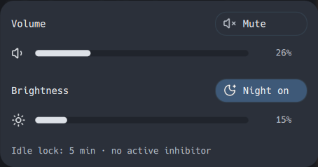
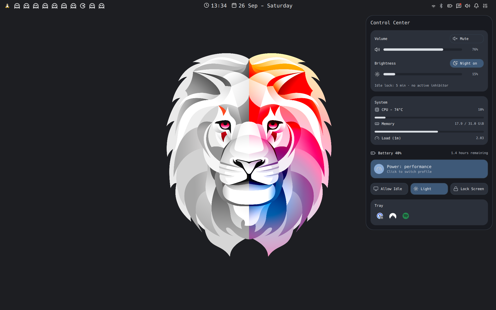
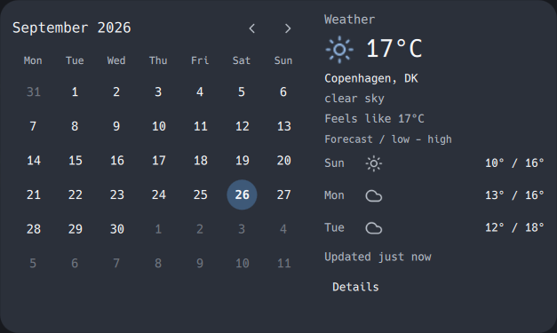
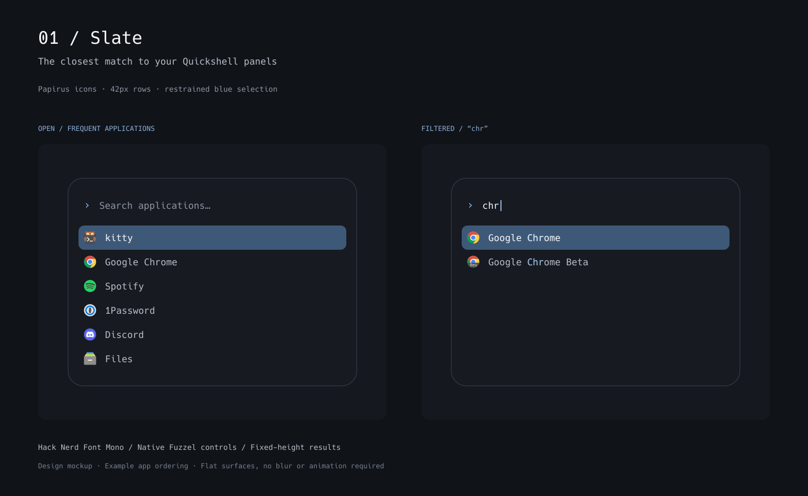
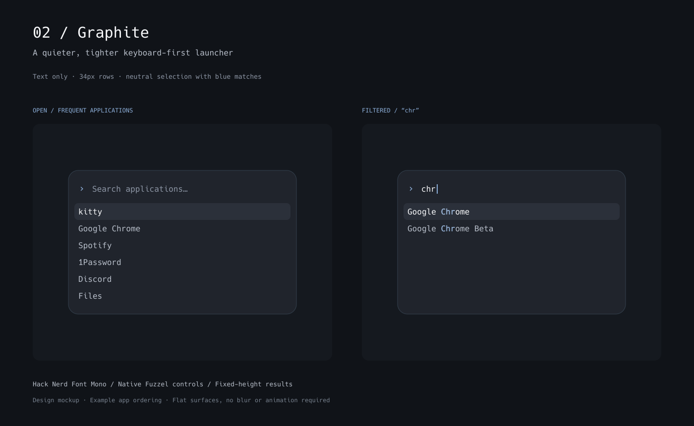
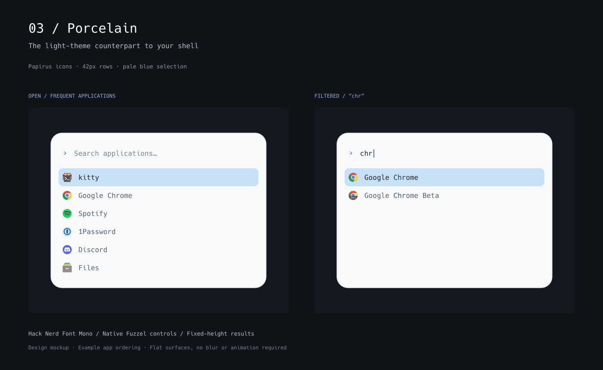

<div align="center">

<h1>Dotfiles</h1>

<h3>A considered Linux desktop, built around the way I work.</h3>

<p>Arch Linux · Hyprland / i3 · Quickshell · Neovim</p>

<p><a href="#desktop">Desktop setup</a> · <a href="#screenshots">Screenshots</a> · <a href="#install">Install</a> · <a href="#repository-guide">Repository guide</a></p>

</div>

<br>

<p align="center"><a href="screenshots/desktop.png"></a></p>

## Desktop

| Component | Setup |
| --- | --- |
| **Window managers** | [Hyprland](https://github.com/hyprwm/Hyprland) on Wayland · [i3](https://i3wm.org/) on X11 |
| **Desktop shell** | [Quickshell](https://quickshell.outfoxxed.me/) bar, panels, notifications, and OSDs |
| **Launchers** | [Fuzzel](https://codeberg.org/dnkl/fuzzel) on Hyprland · [rofi](https://github.com/davatorium/rofi) on i3 |
| **Compositor** | Hyprland effects · [Picom](https://github.com/yshui/picom) for i3 |
| **Editor** | [Neovim](https://neovim.io/) with lazy.nvim |

The configs favor a quiet status surface, quick keyboard workflows, and panels
that reveal detail only when needed. Shared helpers keep the Hyprland and i3
setups familiar across Wayland and X11.

## Screenshots

<table>
  <tr>
    <td width="50%">
      <a href="screenshots/control-center.png"></a>
      <p align="center"><sub>Quickshell · Control Center</sub></p>
    </td>
    <td width="50%">
      <a href="screenshots/calion.png"></a>
      <p align="center"><sub>Quickshell · Calendar and weather</sub></p>
    </td>
  </tr>
</table>

### Fuzzel themes

Three launcher palettes, including a light theme. These are design previews of
the launcher configuration.

<table>
  <tr>
    <td width="33%"><a href="designs/fuzzel/01-slate.png"></a><p align="center"><sub>Slate · default</sub></p></td>
    <td width="33%"><a href="designs/fuzzel/02-graphite.png"></a><p align="center"><sub>Graphite · compact</sub></p></td>
    <td width="33%"><a href="designs/fuzzel/03-porcelain.png"></a><p align="center"><sub>Porcelain · light</sub></p></td>
  </tr>
</table>

## Install

The desktop configuration expects the repository at **`$HOME/dotfiles`** on
Arch Linux.

```sh
git clone https://github.com/lukelex/dotfiles.git "$HOME/dotfiles"
cd "$HOME/dotfiles"
./linux/install/all
```

The full-screen wizard explains the plan, collects component choices, and guides
SSH/GitHub, 1Password, and desktop setup. SSH access and the fonts submodule are
configured inside the wizard. Run `./linux/install/all --server` for a headless
server, or choose a profile in the wizard. For a specific machine:

```sh
./linux/install/all --host <name>
```

The installer uses the system-installed `dotpkg` found on `PATH`. Install or
update it before running the scripts; they do not download a separate version.
For local development, build the frontend and supply it explicitly:

```sh
cd "$HOME/projects/dotpkg"
mkdir -p "$HOME/.local/bin"
go build -o "$HOME/.local/bin/dotpkg-dev" ./cmd/dotpkg
cd "$HOME/dotfiles"
DOTPKG_BIN="$HOME/.local/bin/dotpkg-dev" ./linux/install/all
```

Keep the development binary at that persistent path for login continuation.
No package installation runs during a build.
The launcher reports an unsupported version if the installed binary lacks the wizard.

Use arrows/Space to choose components and Enter to continue. On setup screens,
Enter checks again, **a** runs/retries an action, **o** opens instructions,
**c** copies displayed public information, **d** defers an optional task, and
**l** opens logs. PgUp/PgDn scroll long screens. Password/package prompts use
temporary terminal handoffs. The wizard checks real state on reruns; imperative
installation stages without a check run again rather than trusting saved flags.

Pending desktop onboarding registers a terminal-based graphical-login autostart.
It is removed when setup is completed or optional tasks are explicitly deferred.
`./linux/install/all --resume` continues manually; **r** on the review screen
revisits deferred tasks. Logs and preferences live under
`$XDG_STATE_HOME/dotpkg/wizard-*` (default `~/.local/state/dotpkg/wizard-*`).
Account handoffs and check output are not logged; package/system handoffs have
separate logs when util-linux `script` is available.

`--plain --yes --selections choices.json` enables explicit unattended operation.
Input values use `DOTPKG_INPUT_SHELL`, `DOTPKG_INPUT_TIMEZONE`, and
`DOTPKG_INPUT_SSH_KEY`. Package-only automation also uses `--packages-only` and
requires yay and non-interactive sudo access. Unresolved choices or stages
requiring human interaction fail before actions run; `--yes` does not select
every optional component. `./linux/install/sync` remains the direct maintenance
entrypoint.

## Repository guide

- [`linux/packages.yaml`](linux/packages.yaml) — desktop and server package selections, config links, and services.
- [`linux/install/`](linux/install/) — sync, full setup, verification, and supporting installer steps.
- [`linux/config/`](linux/config/) — application and desktop configurations.
- [`linux/scripts/`](linux/scripts/) — system helpers, installed as `u_*` commands on desktop setups.
- [`linux/hosts/README.md`](linux/hosts/README.md) — host overlay format.
- [`linux/config/fuzzel/README.md`](linux/config/fuzzel/README.md) — launcher themes and shortcuts.

<details>
<summary><strong>How installation works</strong></summary>

`sync` reconciles core packages, groups, config links, and services
from the selected profile using the system-installed `dotpkg` binary. It symlinks
`$XDG_CONFIG_HOME/dotpkg/package.yaml` to the tracked `linux/packages.yaml`;
dotpkg stores machine-local state beside that link.

The `sync` wrapper always passes the repository's core manifest explicitly.
`--refresh-manifest` updates an existing standalone local manifest for subsequent
direct `dotpkg` commands, retaining a backup; it does not change which manifest
the wrapper uses. When the default manifest is already the repository symlink,
refreshing it is a no-op.

Preview the reconciliation with:

```sh
./linux/install/all --dry-run
```

Both `all --dry-run` and `sync --dry-run` are read-only: they do not bootstrap
tools or initialize state. When a required binary or package selection is
missing, the preview explains what cannot yet be resolved. During execution,
existing local manifests are backed up before linking to the repository version.
Pulling repository changes updates the manifest on each linked machine. The
wizard reviews declared config-link conflicts individually; backups are retained
beside their former targets in `.dotpkg-backup-*` directories. Direct `sync`
preserves conflicts unless `--replace` is passed. Use `./linux/install/verify`
to check an existing setup.

Verification is static by default and works from a TTY. Run
`./linux/install/verify --session` inside the desktop to additionally check its
live session and Quickshell service. System configs and helper links preserve
conflicting paths and report an incomplete stage. Explicit `--replace` backs
those paths up in adjacent `.dotfiles-backup-*` directories before replacing
them. Backups are never pruned automatically; inspect and remove individual
backup directories explicitly when no longer needed.

Desktop installation links the `dotfiles-idle` and `dotfiles-lock` user services.
Log out and start a fresh graphical session after installing these links; the
session startup selects and starts the appropriate idle/sleep-lock owner.
Explicit sleep actions wait for the native locker's readiness acknowledgement
and refuse to sleep if locking fails. Lid-close and system-initiated sleep use
hypridle or xss-lock delay inhibitors: their delay is bounded by logind and is
not a guaranteed veto of sleep when locking fails.

### Optional maintenance stages

Remote grill skills and OpenEffects have independent wizard stages and commands:

```sh
./linux/install/optional skills
./linux/install/optional effects
```

Both accept `--dry-run`, `--replace`, and `--restart-services`; skills also accepts
`--server`. Core `sync` does not fetch or update either optional component.
Their manifests are in `linux/optional/`, with separate dotpkg ownership state
under `$XDG_CONFIG_HOME/dotpkg/optional-{skills,effects}/state.yaml`.
OpenEffects native packages remain owned by pacman. Errors are visible and
completed steps are retained: rerun the failed optional command to retry.
Deferring an optional stage leaves an existing installation in place.

**Existing installations:** run the installer wrappers before using direct
`dotpkg sync` or `clean` with the changed core manifest. They refuse to proceed
when legacy optional ownership needs migration. Explicitly run
`python3 linux/install/optional-state.py` to transfer those records under dotpkg's
state locks, preserving full state backups in `dotpkg/optional-state-backup-*`.
Destinations are saved before source
records are removed, so an interrupted transfer can be retried without losing
ownership. Conflicting destination records stop migration for inspection.
Migration also refuses any `state.yaml.journal.yaml` beside the core or optional
state files. Review and resolve recovery with `dotpkg recover --state-file PATH`
and the matching manifest before retrying, even if the journal says completed.
Do not delete a journal to bypass the check.
A read-only preview with legacy ownership reports the required migration.
The migration command performs only that local state transfer.
Do not restore just the old core state after migrating: restore the matching
optional state backups together, with no dotpkg process running. Backup filenames
start with `0-` (core), `1-` (skills), and `2-` (effects). A missing optional backup
means that state file did not exist: move its newly created state file aside when
rolling back. Restore the old manifest declarations with the old ownership state.
No installed resources are removed by migration.

For package and resource maintenance, see `dotpkg --help`.
`dotpkg clean --resources` removes stale, unchanged managed bundles and other
stale managed resources; `dotpkg recover` handles an interrupted package
transaction.

If 1Password is locked or slow during shell startup, the shell continues after a
bounded attempt. Unlock 1Password, then run `secrets-retry` in that shell to load
the shared secret references.

Hyprland screenshots use Satty for editing. The original capture is saved to
`~/screenshots` first and retained if the editor is unavailable, cancelled, or
fails; clipboard failures also leave the saved capture intact.

OpenCode's global config is linked by dotpkg on desktop and server profiles.
It loads repository skills from `~/dotfiles/.opencode/skills` and declares a
remote file bundle for `skills/productivity/grill-me`, `skills/productivity/grilling`, and `LICENSE` from
`mattpocock/skills`. dotpkg copies those requested paths into
`~/.local/share/dotpkg/opencode-skills` without running them. Invoke the skill
with `@grill-me`. Each `linux/install/optional skills` checks the upstream default
branch and updates the managed directory only if its commit or content changed;
an optional 40-character `commit` in `resources.remote_bundles` freezes it.
An unavailable upstream fails that optional stage without blocking core `sync`.
On existing machines, run
`./linux/install/optional skills` to install or update the bundle. Keep the vendored
copies until the managed installation is verified, then remove them to avoid
duplicate skill IDs. Use dotpkg v0.18.0 or newer for this bundle.

### Keyboard device manager

Desktop syncs install KMonad Device Manager **v1.2.1** from a checksum-pinned
GitHub release (amd64). dotpkg owns the binary, bash/fish completions, man page,
license, group membership, config links, and user service. The small
`linux/install/kmonad-device-manager` step prepares the uinput rule and kernel
module before resource reconciliation. Fresh group membership takes effect
after logging out and back in. `--packages-only` skips this system setup.

The service, zsh completion (missing from the upstream release archive), and
device rules in `linux/config/kmonad-device-manager` come from v1.2.1. Keyboard
configs are linked from `linux/config/kmonad`; an existing manager `env` file
continues to override the default config directory.

For upgrades, update `ref`, `archive`, and `sha256` in the manifest's
`kmonad-device-manager` entry, review the vendored service/completion/rules
against the new release, then run `./linux/install/sync --restart-services`.
Release discovery is manual; `dotpkg update` only updates dotpkg itself.
ARM64 hosts need an overlay selecting the matching `linux-arm64.tar.gz` asset
and its checksum.

**Migrating the old checkout-based installation:** before the first managed
sync only, back up its release-file targets. dotpkg deliberately refuses to
overwrite unmanaged files, even with `--replace`. Run this in Bash:

```bash
backup="$HOME/.local/share/kmonad-device-manager-backup-$(date +%Y%m%d%H%M%S)"
for relative in \
  .local/bin/kmonad-device-manager \
  .local/share/bash-completion/completions/kmonad-device-manager \
  .config/fish/completions/kmonad-device-manager.fish \
  .local/share/man/man1/kmonad-device-manager.1 \
  .local/share/licenses/kmonad-device-manager/LICENSE; do
  if [ -e "$HOME/$relative" ] || [ -L "$HOME/$relative" ]; then
    mkdir -p "$backup/$(dirname "$relative")"
    mv "$HOME/$relative" "$backup/$relative"
  fi
done
./linux/install/sync --replace --restart-services
```

The old checkout remains available for rollback. `--replace` switches its
service and zsh-completion symlinks to the dotfiles-managed versions.

### Webcam reactions

Desktop syncs install checksum-pinned OpenEffects 0.1.4 native packages (x86_64)
before dotpkg links its settings and enables its user service on `default.target`.
The GTK preview dependency is declared in the manifest. Reactions are enabled,
the physical camera is autodetected, and capture/effects processing stops when
no application consumes the virtual camera. OpenEffects is managed by pacman,
not dotpkg's package-clean stage, until an upstream package origin is available.

To migrate an existing install, review your local manifest before running:

```sh
./linux/install/sync --refresh-manifest --replace
```

Refreshing backs up the local manifest; `--replace` can replace conflicting
config paths across the desktop profile. Chrome is the shared default browser;
its managed `chrome-flags.conf` enables PipeWire camera support. Fully quit and
reopen Chrome after applying it, then select OpenEffects Virtual Camera in your
calling app.

Microsoft Edge is **not installed**. The `archqms` host overlay additionally
links its flags file for an independently installed Edge. On that machine use
`./linux/install/sync --host archqms --refresh-manifest --replace` and fully quit
and reopen Edge after applying it.

</details>
